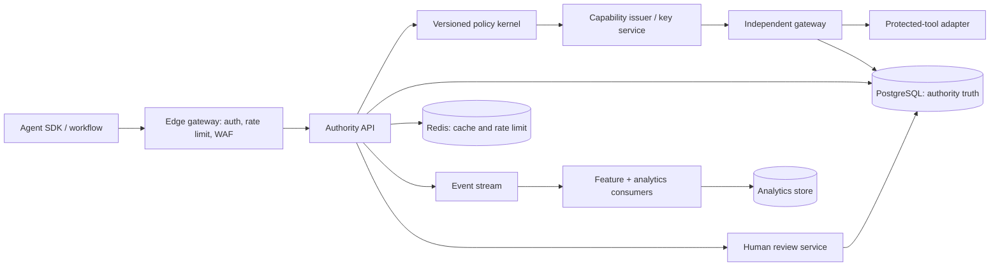

# System Architecture and Deployment Topology

## Architecture principle

Sentra separates the system into independent planes so that no planning model, policy evaluator, notification channel, or analytics service can independently execute a protected action.

| Plane | Responsibilities | Availability behavior |
|---|---|---|
| Edge | Authenticate workload, limit abusive requests, enforce tenant routing, reject malformed inputs. | Reject before the authority plane if ingress controls are unavailable. |
| Authority | Canonicalize, evaluate deterministic policy, create a decision, create capability or review artifact, append evidence. | Fail closed for consequential actions if durable storage or policy version is unavailable. |
| Gateway | Recompute/request-verify binding, validate signature/expiry/scope/nonce, atomically consume capability, invoke adapter. | Never execute on a missing, stale, invalid, already-consumed, or unverifiable capability. |
| Review | Route escalation to entitled human, collect one bounded decision, preserve review evidence. | Notification failure leaves review pending and visible; it never becomes implicit approval. |
| Event and analytics | Publish immutable operational events, calculate advisory features, operate dashboards and model evaluation. | Analytics delay cannot affect an already committed authority decision. |

## Deployment decision gates

The current managed application is appropriate for the controlled MVP. A production deployment should be staged:

1. Managed PostgreSQL, managed Redis, object storage, and a managed stream service for a design-partner pilot.
2. Stateless authority and gateway services horizontally scaled behind a managed regional load balancer.
3. Container build and integration-test pipeline before any Kubernetes adoption.
4. Managed Kubernetes only when independently deployable services, workload isolation, or operational scale justify cluster complexity.
5. Separate analytics from transactional authority storage; never let a warehouse outage interrupt the fail-closed authority path.

## Secrets and keys

Runtime secrets are supplied only through deployment secret stores. Public verifiers receive key metadata or public key material, never HMAC material. The MVP HMAC model must transition to asymmetric signatures backed by managed key operations before multi-service production use.
