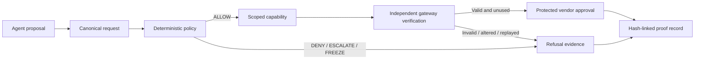

# Functional Prototype Evidence — Sentra Authority OS

**Team:** Brand New Day  
**Prototype type:** Software-only authority-enforcement MVP  
**Primary protected action:** Scoped vendor approval in a protected workspace

## 1. Prototype objective

Sentra demonstrates a runtime decision boundary for autonomous agents. An agent may **propose** an action, but it cannot directly execute a protected workspace action. Sentra canonicalizes the request, evaluates deterministic policy, issues a bounded HMAC-SHA256 capability only where policy permits, verifies that capability at a separate gateway, and then records the outcome in a persistent hash-linked evidence chain.

The prototype is intentionally narrow: one protected vendor-approval action, six inspectable scenarios, and persistent evidence. This narrow scope is a design choice: it makes the authority invariant observable rather than hiding it behind a broad product claim.

## 2. Functional demonstration



The prototype’s invariant is:

> **No valid decision. No valid capability. No protected execution.**

## 3. Scenario evidence

| Scenario | Expected decision | Capability behavior | Protected-action behavior | What a judge should observe |
|---|---|---|---|---|
| Valid Action | `ALLOW` | A narrowly scoped, short-lived capability is issued. | Executes once after gateway verification. | One visible protected state change and a corresponding proof record. |
| Unauthorized Tool | `DENY` | No capability is issued. | No protected tool call. | Tool scope is outside the authority contract. |
| Prompt Injection | `ESCALATE` | No executable authority is issued. | No protected tool call. | Untrusted instruction is preserved as evidence and requires review. |
| Changed Request | `DENY` | A capability bound to the original request cannot authorize a changed request. | No protected tool call. | Request-hash binding blocks the change. |
| Burst Anomaly | `FREEZE` | Authority is not issued. | No protected tool call. | Agent state is contained under the configured burst condition. |
| Replay Attempt | `DENY` | The spent capability is rejected. | No second protected side effect. | Fresh versus consumed authority is visibly distinct. |

## 4. Persisted prototype artifacts

Every decision stores the following evidence fields in the server-backed data model:

| Artifact | Purpose |
|---|---|
| Canonical request and request hash | Captures the exact scope, identity, resource, tool, intent, workflow, and idempotency binding. |
| Policy version and reason code | Shows which deterministic rule snapshot made the decision. |
| Capability and capability hash | Captures issued authority only for an allowed, exact request. |
| Gateway and execution results | Separates policy output from actual protected-tool enforcement. |
| Previous and current record hashes | Builds an ordered, tamper-evident local evidence chain. |
| Escalation artifact, where relevant | Preserves the original request hash, workflow context, required approver role, and expiry. |

The supplied authority-event export contains persisted scenario records, while the capability export shows the generated capability records. These are evidence exports from the controlled prototype; they are not a substitute for an independent audit.

## 5. Reproducibility and test evidence

The project’s validated current state includes **33 automated tests across 9 test files**, a clean TypeScript check, and a successful production build. Coverage includes canonicalization, policy outcomes, scope binding, signature alteration refusal, capability expiry, revoked-key refusal, replay prevention, direct protected-tool rejection, escalation binding, proof export, and proof-chain sensitivity.

Use the following local or managed-environment verification path:

```bash
pnpm install
pnpm test
pnpm check
pnpm build
pnpm dev
./verify-demo.sh
```

`verify-demo.sh` resets the controlled baseline, runs all six scenarios through the server, checks that one scenario creates a permitted protected-state change while the adverse scenarios do not, and confirms the proof-chain structure. It is a repeatable MVP validation step, not a security certification.

## 6. Current prototype boundary

| Demonstrated now | Explicitly not claimed |
|---|---|
| Server-persisted decisions, capabilities, protected-resource state, and proof records | Production availability, durability, or incident-response guarantees |
| Deterministic authority outcomes for the defined software scenarios | Coverage of every model, tool, tenant, or enterprise workflow |
| HMAC-SHA256 shared-secret MAC verification in a controlled demo | Public-key signatures or legal non-repudiation |
| A module-sealed protected-tool adapter in the MVP codebase | A third-party penetration test or formal security certification |
| Exportable local proof package | An external audit attestation |

## 7. Public-demo readiness note

The managed/local prototype environment is the evidence source for the functional demonstration. A public Vercel static deployment is available, but the authority API requires `DATABASE_URL` and `JWT_SECRET` in the Vercel production environment before it can be represented as a database-backed live demo. Until that configuration is completed, use the managed/local demonstration environment for judge execution and do not claim the public URL has live persistent authority data.

## References

[1]: ../../README.md "Sentra Authority OS repository README"
[2]: ../../verify-demo.sh "Repeatable six-scenario authority verifier"
[3]: ../../server/authority.ts "Deterministic authority engine"
[4]: ../../server/routers.ts "Authority API routes"
[5]: ../../SENTRA_THREAT_MODEL.md "Threat and control matrix"
