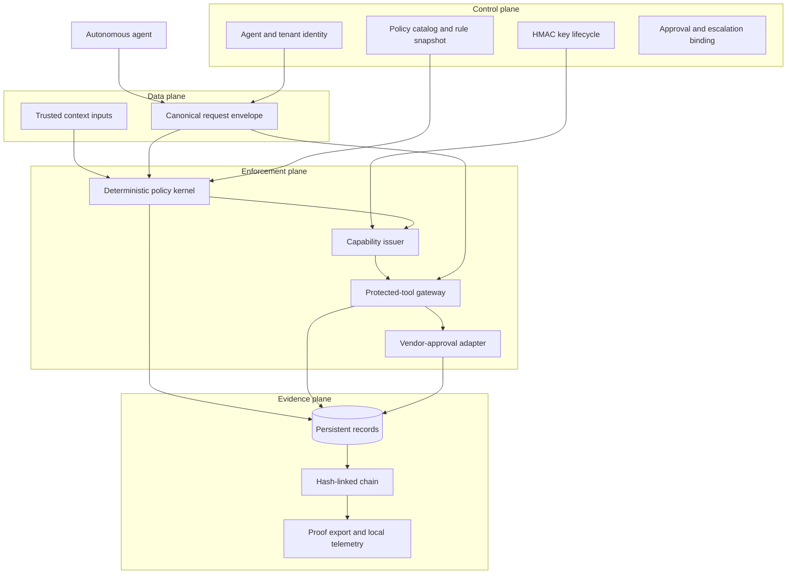
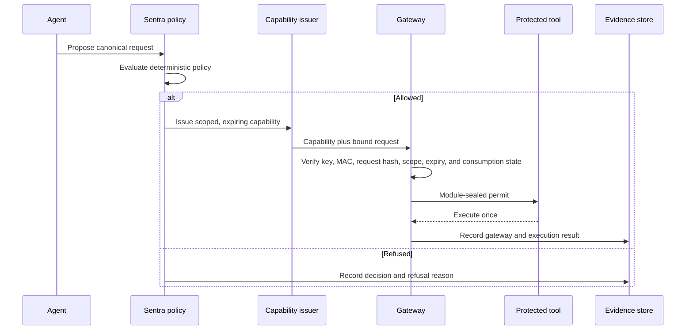

# Technical Documentation — Sentra Authority OS

## 1. Technical problem

Autonomous agents can generate convincing requests, but generated intent is not proof of authority. If a planning model can invoke a protected tool directly, a malformed request, prompt injection, altered context, or replayed approval can turn a proposed action into an unapproved side effect.

Sentra separates **proposal**, **authorization**, **enforcement**, and **evidence**. The model proposes; deterministic policy decides; a capability binds an exact permitted operation; the gateway enforces; the proof chain records what happened.

## 2. Architecture

| Plane | Implemented responsibility |
|---|---|
| **Control** | Identity-related request fields, versioned policy availability, key status, workflow binding, and escalation conditions. |
| **Data** | Stable canonical request envelope and deterministic decision inputs. |
| **Enforcement** | Capability issuance, scope and hash verification, single-use enforcement, and protected tool invocation. |
| **Evidence** | Persistent authority events, chained hashes, local operational metrics, and JSON proof export. |

## 3. Canonical authority envelope

Sentra normalizes each request before policy is evaluated. The current envelope binds the following fields to the decision context:

| Group | Bound fields |
|---|---|
| Identity and tenancy | `tenantId`, `agentId` |
| Target | `tool`, `resource`, `action`, `desiredState` |
| Business bounds | `amountOrLimit`, `currency`, `purpose` |
| Execution context | `workflowId`, `workflowStep`, `stepBudget`, `nonce`, `idempotencyKey` |
| Governance | `policyVersion`, context inputs, request ID |

The canonical representation is hashed. That hash becomes a binding input to the capability and evidence record. A request that changes after an approval attempt does not remain authorized merely because it shares a high-level task name.

## 4. Deterministic decision kernel

The defined outcomes are `ALLOW`, `DENY`, `ESCALATE`, and `FREEZE`.

| Outcome | Meaning in the MVP | Gateway result |
|---|---|---|
| `ALLOW` | The request is in scope and passes the bounded checks. | A capability may be verified and consumed once. |
| `DENY` | The request, tool, or request binding is not valid for execution. | No protected call is permitted. |
| `ESCALATE` | Untrusted content or another review condition requires human handling. | No protected call is permitted; a hash-bound review artifact is created. |
| `FREEZE` | An anomaly condition contains the agent state. | No protected call is permitted. |

The policy kernel is deliberately local and deterministic for the hackathon demo. It is not presented as a complete enterprise policy engine.

## 5. Capability lifecycle and protected gateway

An allowed decision can produce a short-lived capability with a unique identifier, expiry, request binding, HMAC key metadata, and workflow/idempotency binding. The gateway rechecks the capability before calling the protected adapter.

The protected vendor-approval adapter does not accept a general client flag. It accepts a module-sealed permit passed by the gateway after verification. Tests cover rejection of direct adapter use in the controlled implementation.

## 6. Evidence and integrity model

Every event stores its prior record hash and its current record hash. The current hash is calculated over relevant decision material and the prior value, producing an ordered local chain. Verification checks the sequence and record content in the controlled data store.

The proof package contains chronological records, verification status, policy history, key lifecycle metadata, and local metrics. This supports a reviewer’s inspection of a demo run. It does **not** provide independently witnessed time-stamping, public-key non-repudiation, or external attestation.

## 7. Implementation stack

| Layer | Current technology |
|---|---|
| Web interface | React 19, Tailwind CSS 4, responsive light-mode judge dashboard |
| API contract | tRPC 11 over Express 4 |
| Server authority logic | TypeScript deterministic policy and gateway modules |
| Persistence | MySQL/TiDB through Drizzle ORM |
| Validation | Vitest, TypeScript check, production build, repeatable server-side verifier |
| Deployment configuration | Vite static client plus Vercel serverless adapter; production database variables are separately required |

## 8. Security and operational limitations

The technical design contains meaningful runtime controls for a limited demonstration, but it should not be overrepresented. The implementation has not undergone a third-party penetration test; it uses a shared-secret MAC rather than public-key signing; it does not integrate with a live enterprise identity provider, payment system, or ERP; and its local metrics are not a production observability platform. Required production work includes external key management, stronger tenant isolation, policy administration workflow, real approvals, integration-specific adapters, load testing, incident response, and independent security review.

## 9. Reproducibility checklist

1. Install dependencies with `pnpm install`.
2. Run `pnpm test`, `pnpm check`, and `pnpm build`.
3. Start the managed/local server with `pnpm dev`.
4. Run `./verify-demo.sh` or the six visible judge scenarios.
5. Confirm exactly one allowed state change, refused adverse paths, and a valid proof chain.

## References

[1]: ../../README.md "Sentra Authority OS repository README"
[2]: ../../ARCHITECTURE_DECISIONS.md "Architecture decision record"
[3]: ../../SENTRA_THREAT_MODEL.md "Threat and control matrix"
[4]: ../../server/authority.ts "Authority policy and evidence implementation"
[5]: ../../server/authority.ts "Protected-tool gateway implementation within the authority engine"
