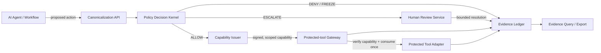

# Sentra Runtime Authority Layer — Technical Architecture and API Schema

## 1. Purpose and non-negotiable invariant

Sentra is a **runtime authority layer** placed between an AI agent’s proposed software action and a protected tool. It does not decide whether an agent’s prose is persuasive. It decides whether a precisely identified action is authorized **now**, in a defined context, and records evidence of the result.

> **Invariant:** A protected side effect may occur only when an independent gateway verifies a valid, unexpired, unconsumed capability that is bound to the exact canonical request.

This design follows the principle that high-impact agent actions require downstream, complete mediation rather than reliance on model output alone.[1] The current Sentra MVP demonstrates the invariant against one protected workspace action; the production architecture below generalizes the boundary without claiming that the current prototype is production-certified.

## 2. Logical architecture



| Plane | Primary components | Responsibility | Trust boundary |
|---|---|---|---|
| **Ingress** | Agent SDK, API gateway, canonicalizer | Accept a proposed action and normalize it into a stable contract. | Agent input is untrusted until normalized and authenticated. |
| **Control** | Policy kernel, policy catalog, key service, capability issuer | Return `ALLOW`, `DENY`, `ESCALATE`, or `FREEZE`; issue authority only for `ALLOW`. | A policy result is not an execution permission until a gateway checks a valid capability. |
| **Enforcement** | Per-tool gateway and adapter | Verify scope, expiry, signature, request binding, replay status, and idempotency before calling a tool. | The adapter is the final execution boundary; agent code must not bypass it. |
| **Human review** | Review registry, reviewer identity, notification delivery | Resolve a bounded escalation only after reviewer authorization. | Notification delivery is not authority; a link and a reviewer-held factor are both required. |
| **Evidence** | Append-only event store, proof-chain worker, exporter | Preserve decision, capability, gateway, execution, and review evidence. | Evidence is inspectable; secrets and raw sensitive payloads require redaction controls. |

## 3. Runtime data flow

| Step | Component | Input | Output | Required control |
|---|---|---|---|---|
| 1 | Agent SDK | Intended tool action | `AuthorityRequest` | Client identity and idempotency key. |
| 2 | Canonicalizer | Request payload | Canonical JSON and `request_hash` | Stable serialization; reject missing scope fields. |
| 3 | Policy kernel | Canonical request and current policy version | `Decision` | Deterministic rules, risk signals, and explicit reason code. |
| 4 | Capability issuer | `ALLOW` decision | Signed `Capability` | Bind capability to `request_hash`, tenant, tool, resource, action, workflow, expiry, and nonce. |
| 5 | Gateway | Request plus capability | Gateway verdict | Verify signature, scope, policy/key state, expiry, nonce, idempotency, and single consumption. |
| 6 | Protected adapter | Verified gateway permit | Tool result | Execute exactly once or fail closed. |
| 7 | Evidence writer | All prior artifacts | Chained `AuthorityEvent` | Commit outcome and hashes before response; do not silently omit an adverse outcome. |
| 8 | Review service | `ESCALATE` artifact | Bounded `APPROVED` or `DENIED` review | Review closure never retroactively executes the original untrusted action. |

## 4. Core API contract

### 4.1 Canonical request

```json
{
  "request_id": "req_01J...",
  "idempotency_key": "client-generated-uuid",
  "tenant_id": "tenant_acme",
  "agent_id": "procurement-agent-01",
  "actor_subject": "service:procurement-agent-01",
  "tool": "workspace.vendor.approve",
  "resource": "workspace/vendor-intake/contoso",
  "action": "approve_vendor",
  "desired_state": "APPROVED",
  "purpose": "Approve Contoso within the vendor-onboarding workflow.",
  "limit": { "amount": 12000, "currency": "USD" },
  "workflow": { "id": "vendor-onboarding-contoso", "step": "vendor_approval", "step_budget": 1 },
  "context": { "source": "vendor-risk-assessment", "risk_score": 72 },
  "nonce": "base64url-random-value",
  "policy_version": "sentra-policy-v1",
  "requested_at": "2026-08-16T05:34:11.197Z"
}
```

The service canonicalizes field ordering and hashes the complete normalized request. The hash, not an informal summary, is the object bound into any capability.

### 4.2 Decision endpoint

`POST /v1/authority/decisions`

| Item | Contract |
|---|---|
| Authentication | Workload identity, mTLS, signed service token, or enterprise workload federation in production. |
| Idempotency | `Idempotency-Key` header must match `idempotency_key` in the body. Repeated calls return the prior material result. |
| Request | A canonical request or the raw input needed to create one. |
| Success response | A decision record; an `ALLOW` response may include a capability. |
| Failure behavior | Invalid identity, unknown policy, unavailable key, malformed request, or persistence failure must fail closed. |

```json
{
  "event_id": "evt_01J...",
  "decision": "ALLOW",
  "reason_code": "POLICY_ALLOW",
  "policy_version": "sentra-policy-v1",
  "request_hash": "sha256:...",
  "capability": { "capability_id": "cap_01J...", "token": "signed-capability" },
  "gateway_required": true,
  "expires_at": "2026-08-16T05:39:11.197Z"
}
```

Adverse responses use the same envelope but omit a capability.

```json
{
  "event_id": "evt_01J...",
  "decision": "ESCALATE",
  "reason_code": "UNTRUSTED_INSTRUCTION",
  "request_hash": "sha256:...",
  "review": {
    "review_id": "review_01J...",
    "required_role": "procurement-controller",
    "expires_at": "2026-08-16T05:49:11.197Z"
  },
  "gateway_required": true
}
```

### 4.3 Capability schema

The current MVP uses an HMAC-SHA256 capability for a controlled demonstration. A production deployment should use a key-management-backed signing service and an asymmetric signed token or equivalent verifier-safe credential so per-gateway verification does not require distributing a shared signing secret.

```json
{
  "capability_id": "cap_01J...",
  "issuer": "sentra.authority",
  "audience": "gateway:workspace.vendor.approve",
  "tenant_id": "tenant_acme",
  "request_hash": "sha256:...",
  "tool": "workspace.vendor.approve",
  "resource": "workspace/vendor-intake/contoso",
  "action": "approve_vendor",
  "desired_state": "APPROVED",
  "workflow": { "id": "vendor-onboarding-contoso", "step": "vendor_approval", "step_budget": 1 },
  "idempotency_key": "client-generated-uuid",
  "nonce": "base64url-random-value",
  "policy_version": "sentra-policy-v1",
  "key_id": "sentra-ed25519-k2026-08",
  "issued_at": "2026-08-16T05:34:11.197Z",
  "expires_at": "2026-08-16T05:39:11.197Z",
  "use_limit": 1,
  "signature": "base64url-signature"
}
```

### 4.4 Gateway execution endpoint

The agent must not call a protected tool directly. It calls the gateway, which owns the adapter.

`POST /v1/gateway/execute`

```json
{
  "request": { "request_id": "req_01J...", "tool": "workspace.vendor.approve", "resource": "workspace/vendor-intake/contoso", "action": "approve_vendor" },
  "capability": "signed-capability",
  "idempotency_key": "client-generated-uuid"
}
```

| Gateway verification | Mandatory result |
|---|---|
| Token signature and issuer/key state | Reject invalid, revoked, unavailable, or unknown keys. |
| Capability expiry | Reject expired credentials. |
| Exact request hash | Reject any changed request. |
| Tenant, tool, resource, action, workflow, and limit scope | Reject scope mismatch. |
| Nonce and idempotency binding | Reject mismatch or duplicate request semantics. |
| Atomic consumption | Mark the capability consumed before or atomically with the protected side effect. |
| Evidence persistence | Record the gateway verdict and adapter result. |

```json
{
  "event_id": "evt_01J...",
  "gateway_verdict": "VERIFIED",
  "execution": { "status": "EXECUTED", "adapter_receipt": "receipt_01J..." },
  "record_hash": "sha256:..."
}
```

### 4.5 Mobile review endpoint

The notification system is a **delivery channel only**. In the current controlled demo, the phone link and a separate dashboard-held reviewer code are both required. In production, replace the code with authenticated, policy-bound reviewer identity and step-up verification where appropriate.

`POST /v1/reviews/{review_id}/resolve`

```json
{
  "decision": "APPROVED",
  "review_token": "one-time-link-token",
  "reviewer_assertion": "authenticated-reviewer-session-or-step-up-proof"
}
```

```json
{
  "review_id": "review_01J...",
  "status": "APPROVED",
  "resolution_event_id": "rev_01J...",
  "message": "Review closed. The original request remains blocked and requires a new authority decision."
}
```

**Important:** A review approval does not turn an old `ESCALATE` request into an executable request. It closes a review artifact. A fresh request must traverse canonicalization, policy, capability issuance, and gateway verification again.

### 4.6 Evidence and export endpoints

| Endpoint | Purpose |
|---|---|
| `GET /v1/evidence/events/{event_id}` | Inspect canonical request, decision, capability metadata, review state, gateway verdict, execution result, and proof hashes. |
| `GET /v1/evidence/verify?from=...&to=...` | Verify a proof-chain range and return the first failing record, if any. |
| `POST /v1/evidence/exports` | Create a redacted evidence package for an authorized investigator or auditor. |
| `GET /v1/policies/{version}` | Retrieve the immutable policy snapshot used for a decision. |
| `GET /v1/keys/{key_id}` | Retrieve public verification metadata and key lifecycle state; never return signing material. |

## 5. Persistence model

| Record | Required fields | Purpose |
|---|---|---|
| `authority_events` | event ID, canonical request, request hash, outcome, reason, policy version, capability/review hashes, gateway result, execution result, previous hash, record hash | Primary append-only decision evidence. |
| `capabilities` | capability ID, request hash, status, expiry, consumption timestamp, key ID | Prevent reuse and make capability lifecycle auditable. |
| `review_requests` | review ID, original event ID, token hash, reviewer requirement, expiry, status, resolution timestamp | Bind human review to one specific escalation. |
| `protected_resources` | resource key, adapter type, current state, version | Provide a concurrency-aware view of the protected system boundary. |
| `policy_versions` | policy version, immutable rules, activation interval, retirement status | Ensure historical decisions are explainable under the policy that issued them. |
| `key_registry` | key ID, public verification material/metadata, status, activation and rotation boundaries | Make revoked or unavailable signing keys fail closed. |

For production, use an append-only or tamper-evident evidence store, strict tenant partitioning, encryption at rest, least-privilege database roles, retention policy, and redaction/minimization controls. A hash chain detects internal inconsistency but is not, by itself, a substitute for independent audit storage, legal retention, or non-repudiation.

## 6. Failure policy

| Failure | Required outcome |
|---|---|
| Policy unavailable or version unknown | `DENY` or `FREEZE`; no capability. |
| Signing key unavailable, revoked, or unknown | `DENY`; no gateway execution. |
| Evidence store unavailable | Fail closed for consequential actions; do not execute without an auditable decision. |
| Duplicate idempotency key | Return the original material result; do not execute twice. |
| Gateway timeout after tool invocation uncertainty | Mark `UNKNOWN_EXECUTION_STATE`, reconcile with adapter receipt, and block automatic retry until resolved. |
| Human review expires | `DENY`; require a new request. |
| Notification fails | Preserve the escalation and expose a local review queue; notification delivery is never proof of review. |

## 7. Current MVP versus production architecture

| Area | Controlled MVP | Production requirement |
|---|---|---|
| Signing | HMAC-SHA256 controlled-demo MAC | KMS/HSM-backed asymmetric signing or tightly isolated verifier architecture. |
| Identity | Demo agent and reviewer values | Workload identity, enterprise SSO, delegated authorization, and role lifecycle. |
| Human review | One-time link plus dashboard-held code | Authenticated queue, reviewer entitlement, step-up policy, and durable notification handling. |
| Tool integration | One simulated protected workspace adapter | Real adapters with transactional receipts, rate limits, and reconciliation. |
| Evidence | Local persistent hash-linked events | Tenant isolation, immutable storage strategy, retention, redaction, and independent review. |
| Availability | Managed temporary demo environment | HA control plane, regional design, incident response, monitoring, and SLOs. |

## 8. Recommended implementation sequence

1. Integrate one real but low-risk protected SaaS action behind the gateway.
2. Add workload identity and an authenticated reviewer queue before expanding human approvals.
3. Run shadow decisions to compare Sentra policy with the existing operating process.
4. Add one enforcement pilot with explicit rollback and manual override procedures.
5. Move signing and key lifecycle to managed key infrastructure; add tenant isolation and observability.
6. Commission an independent security review only after the real integration and threat model stabilize.

## References

[1] [OWASP GenAI Security Project, *LLM06:2025 Excessive Agency*](https://genai.owasp.org/llmrisk/llm062025-excessive-agency/)

[2] [NIST, *AI Agent Standards Initiative*](https://www.nist.gov/artificial-intelligence/ai-agent-standards-initiative)
